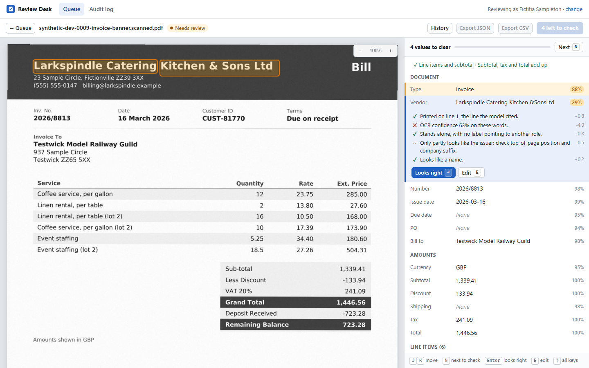
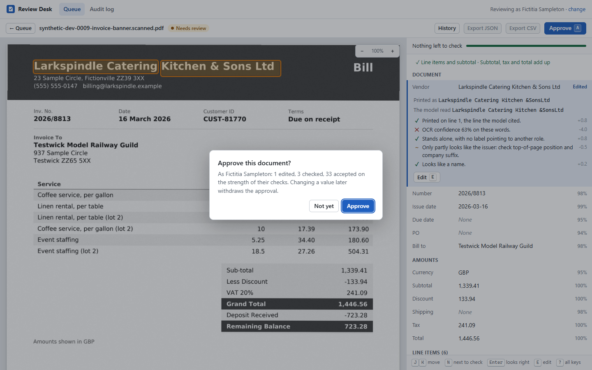
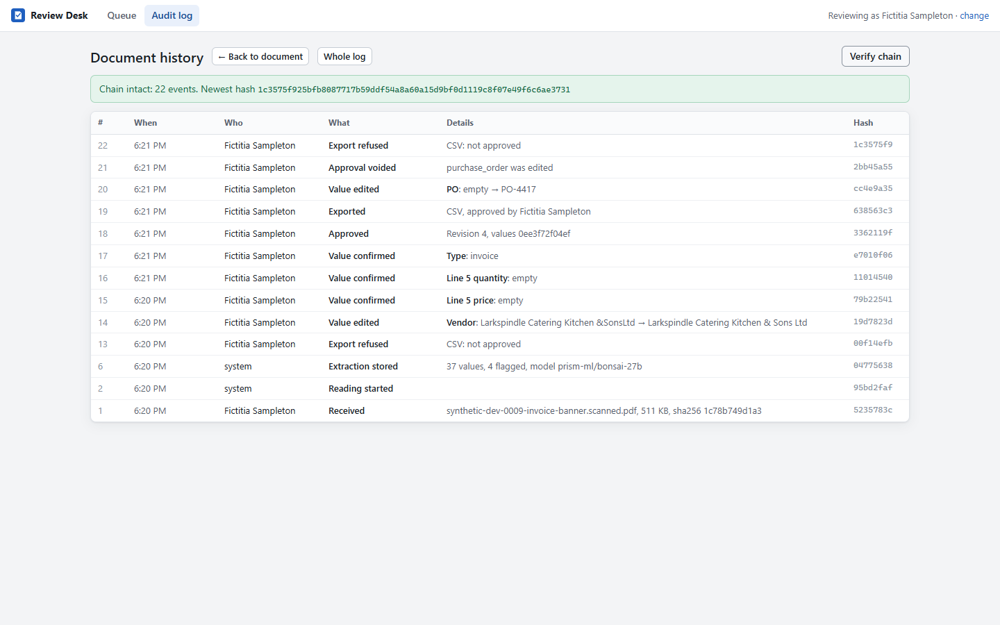
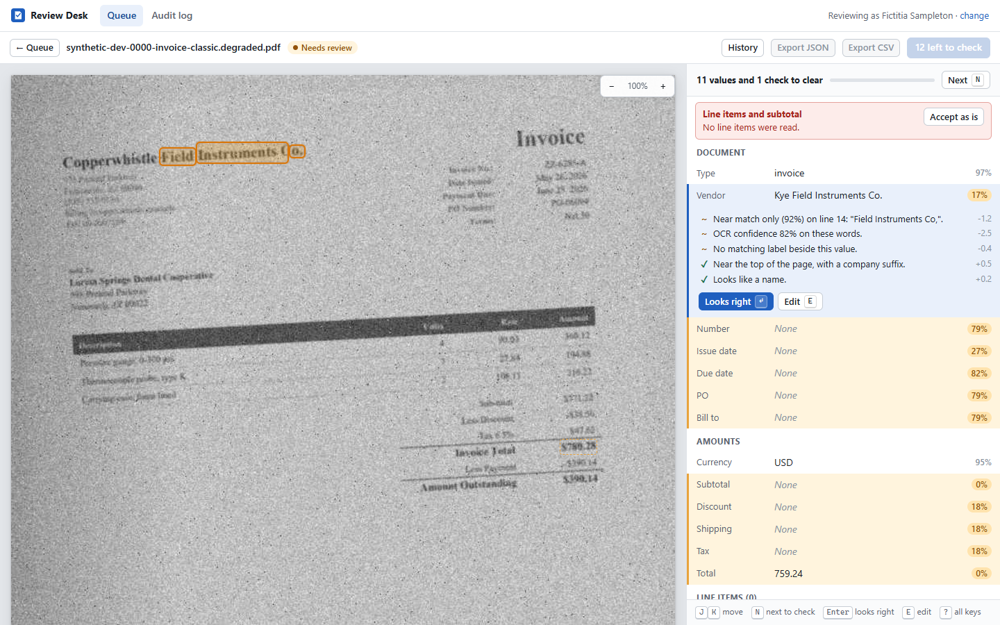
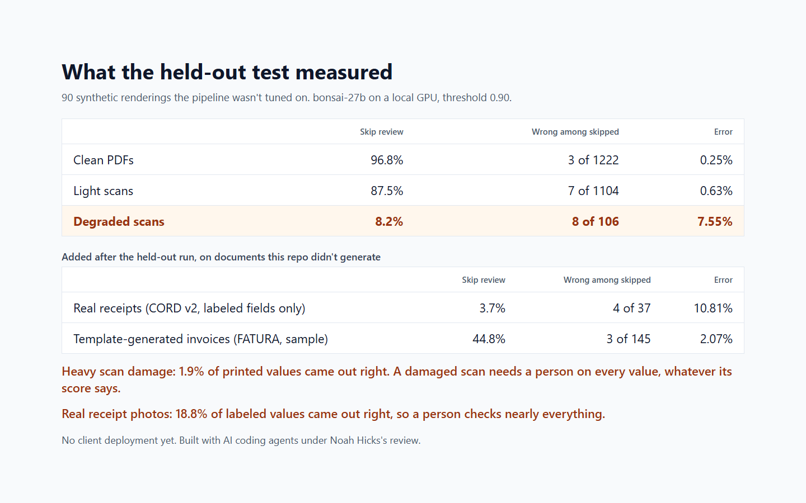

# Review Desk

Upload an invoice or receipt PDF and get checked data out, with no outside connections. Fields are
extracted against a strict schema, each with a confidence score built from checks you can inspect and
its source highlighted on the page. Low-confidence fields go to a review queue, nothing exports until a
person approves it, and a hash-chained audit log records what happened.

**[Watch the demo](docs/media/demo.mp4)** (73 seconds, no sound). It uses synthetic documents and replays saved
answers from a real evaluation run.



**A portfolio project, with no client deployment yet.** Built with AI coding agents under Noah Hicks's review.

## What it measured

These come from a held-out set of 30 synthetic base documents, 90 renderings, at a 0.90 threshold. Its vendor names and
three of its layouts were never used while tuning, it ran once per model, and the threshold and scoring rules were fixed first.
"Skip review" means a person isn't asked to check that value, so the last column is the number that matters most.

| Condition | Values | Skip review | Wrong among those skipped |
|---|---|---|---|
| Clean PDF | 1262 | 96.8% | 3 of 1222 (0.25%) |
| Light scan | 1262 | 87.5% | 7 of 1104 (0.63%) |
| **Degraded scan** | 1294 | **8.2%** | **8 of 106 (7.55%)** |

If you check scanned paperwork, read this part:

- **Degraded scans are weak.** Few values skip review there, and 7.55% of those that did were wrong. Check every value on a
  bad scan, whatever its score says.
- **Heavy scan damage fails.** 1.9% of printed values came out right, because OCR could read only 15.7% of them. Moderate
  damage got 51.5% right. A light scan got 96.0%, and a clean PDF 98.8%.
- **Real receipt photos go badly.** On CORD v2's test split of 100 real receipts, 18.8% of labeled values came out right and OCR
  could read 56.1% of them. 3.7% skipped review, 4 of those 37 were wrong (10.81%), and no receipt passed with nothing flagged. A
  person ends up checking nearly everything, so this build saves little reading work on photos.
- **Other people's templates go better, on clean images.** On 50 template-generated FATURA invoices, 92.9% of labeled values
  came out right. 44.8% skipped review and 3 of those 145 were wrong (2.07%). No invoice passed with nothing flagged.
- **Wrong values do get through.** Across the held-out conditions, 18 of the 2432 values that skipped review were wrong. Many are a
  name or description that looks fine and has no arithmetic to catch it.
- **It's slow.** About a minute per synthetic document on an 8 GB GPU, with the model reading OCR text and no page images. A
  vision model or better OCR on photos is the obvious next test, and neither has been run here.

CORD and FATURA were added after the held-out run and tuned on nothing. CORD's labels cover only line items, subtotal, tax, discount and
total. FATURA is generated from templates, so it isn't real paper. A small synthetic set for bad arithmetic came afterward too, because the held-out
set happened to have none: all 36 renderings carrying a known bad sum had something flagged, and the sum's own check failed on 11 of 13 clean PDFs,
9 of 13 light scans and 4 of 13 degraded scans. One document carries two mistakes and counts under both.

The model is `prism-ml/bonsai-27b` (1-bit quantization, 8192 context, temperature 0). It was picked over `granite-4.1-8b` on the dev
split alone, by [a bar committed before any Granite run](docs/MODEL_CHOICE.md). Granite's held-out numbers sit beside it in the report: 60.4%
skipped with 1.04% wrong, against 63.7% with 0.74%, at half the time per document. Every table, by field and by condition, is in
**[results/REPORT.md](results/REPORT.md)**, and every number there traces to a run under [results/](results/README.md).

| | |
|---|---|
|  |  |
|  |  |

## Try it without a model

Needs Python 3.12 and [Tesseract](https://github.com/tesseract-ocr/tesseract) 5. If Tesseract isn't on your PATH, set `TESSERACT_CMD`.

```
python -m venv .venv
.venv/Scripts/python -m pip install -r requirements.txt -r requirements-dev.txt -e .   # .venv/bin/python on macOS and Linux
.venv/Scripts/python -m review_desk.synth generate --split dev --count 15
.venv/Scripts/python -m review_desk.desk serve --replay results/runs/dev-bonsai
```

Open http://127.0.0.1:8765 and drop in PDFs from `data/synthetic/dev`. To read your own documents, point it at any OpenAI-compatible
server: copy `.env.example` to `.env`, and leave out `--replay`.

## How a document gets read

```
.venv/Scripts/python -m review_desk extract invoice.pdf
```

1. **Intake.** Uploads are untrusted: size and page limits, encrypted and malformed files refused, active
   content detected and reported. Scripts never run, because the code never creates the form environment
   PDFium needs to run them.
2. **Words with coordinates.** Digital PDFs use their text layer. Scans go through Tesseract after being
   straightened and cleaned at their native resolution, with word boxes mapped back to the original page.
   Digital PDFs get OCR'd too, as a check: a text layer can claim anything, so text that doesn't match the
   visible page is flagged, and a page whose hidden text mostly isn't visible gets read from its pixels.
3. **The model copies, it doesn't compute.** A local model (LM Studio by default, any OpenAI-compatible
   endpoint set by environment variables) gets numbered lines and returns literal values with line
   citations, under a strict JSON schema. Dates and amounts get parsed in Python. Document text is treated as
   data, and this is the only network call in the app.
4. **Earned confidence.** The model's opinion of itself is never used. Each field is scored on whether it's
   printed where the model said, how sure OCR was, whether a matching label sits beside it, and whether the
   numbers add up. [docs/CONFIDENCE.md](docs/CONFIDENCE.md) has the signals and what they can't catch.

## The review desk

```
.venv/Scripts/python -m review_desk.desk serve                                # uses your model endpoint
.venv/Scripts/python -m review_desk.desk serve --replay results/runs/dev-bonsai  # no model needed
.venv/Scripts/python -m review_desk.desk verify                               # recompute the audit chain
```

Then open http://127.0.0.1:8765. Each document opens with its page beside its fields. Picking a field
highlights where it's printed and lists the checks behind its score, and flagged values come first. The review
can be done from the keyboard: `J`/`K` move, `N` jumps to the next value to check, `Enter` accepts, `E` edits,
`A` approves, `]` goes to the next document, `?` lists the rest.

`--replay` answers from a finished evaluation run instead of calling a model. It matches files by hash, so
generate the same documents first (`python -m review_desk.synth generate --split dev --count 15`). Scans may
only match on the same platform and pinned versions, and any file it doesn't know shows the failure screen.

### What the server enforces

These rules live in the server, in [store.py](src/review_desk/desk/store.py), and tests call the API directly to
check that the screen isn't what's holding them up.

- **Nothing exports until a person approves.** Export is refused before approval, and after any later edit.
- **An approval covers exact values.** It stores a hash of what was approved. If a value changes any other way,
  including directly in the database, the hashes disagree, export refuses, and the approval is voided and logged.
- **Approval waits for the work.** Every flagged value has to be confirmed or corrected, and every failed sum
  acknowledged. The request also has to name the revision on screen, so nobody approves values they haven't seen.

### The audit log

Every action lands in the same transaction as its event: who, what, when, old and new values. Each event's hash
covers the one before it, so editing, removing or reordering an event breaks the chain from that point. The newest
hash is also kept in a separate file, which catches events cut off the end. `verify` recomputes all of it.

The limit: someone who can rewrite both the database and that file can build a new chain from scratch. Keeping the
newest hash somewhere else closes that, and every export carries the hash at that moment.

### Untrusted files

- PDFs are parsed and rendered in a child process with a time limit, so a hostile file costs one failed
  document. The server itself only ever serves the images that process wrote.
- Size and page limits apply. Files are stored under generated ids, so a filename never reaches a path. All
  document text reaches the screen as text, never as markup, and CSV cells that could run as formulas are neutralized.
- It listens on localhost and refuses other addresses unless told otherwise, because there's no login. Pages on
  other sites can't drive it: state-changing requests need a custom header, Host and Origin are checked, and a
  strict content security policy keeps scripts local. Nothing loads from outside, including fonts.

## Synthetic test documents

Accuracy needs known answers, and real invoices can't be published. `review_desk.synth` generates
invoices and receipts from a seed and writes each PDF beside a truth file listing every field's value and
where it's printed. **Everything it produces is synthetic**: invented companies and people, phone numbers
in the 555-01xx range, `.example` domains, a visible notice on every page, and "synthetic" in file names
and PDF metadata.

```
python -m venv .venv
.venv/Scripts/python -m pip install -r requirements.txt -r requirements-dev.txt -e .   # .venv/bin/python on macOS and Linux
.venv/Scripts/python -m review_desk.synth generate --split dev --count 60
.venv/Scripts/python -m review_desk.synth overlay data/synthetic/dev/<name>.degraded.pdf --out overlay.png
.venv/Scripts/python -m pytest
```

Each document renders in three conditions, so a difference in scores between them comes from image
quality and not from the content:

| Condition | What it is |
|---|---|
| `clean` | A digital PDF with its text layer. |
| `scanned` | An image with no text layer: 170 to 240 DPI, skew under 0.4 degrees, light noise. |
| `degraded` | A bad scan, moderate or heavy: as low as 84 DPI, skew up to 4 degrees, blur, noise, speckle, fading, an edge shadow, hard JPEG compression. |

The skew and padding go through a transform this code computes, so the truth boxes move with the pixels
and field locations stay exact on a skewed page.

The documents carry the traps that catch extractors out:

- Five invoice layouts and three receipt layouts, with label wording, fonts, page sizes and locales that
  vary by seed.
- Two more invoice layouts and one receipt layout appear only in the held-out split, along with a separate
  pool of vendor names. One states the details in a sentence, and another splits tax across two lines.
- Numbers that aren't the answer: balance due after a deposit, cash tendered and change, customer IDs,
  order dates, ship-to names, remit-to companies, bank details.
- Day-first dates, decimal commas, multi-page invoices, wrapped descriptions, white text on color.
- Printed mistakes, flagged in the truth: a total that doesn't add up, a column that doesn't sum, a line
  amount that disagrees with its quantity and price, a missing invoice number. The truth records what's
  printed, not what should have been.

`samples/` holds a few generated documents to look at. Everything else regenerates from the seed. The demo and images come from
[scripts/record_demo.py](scripts/record_demo.py), which drives the real app on these documents.

## Licensing

MIT, `Copyright (c) 2026 Noah Hicks`. Every pinned dependency is under a permissive license, and
`scripts/check_licenses.py` fails if that stops being true. See [THIRD_PARTY_LICENSES.md](THIRD_PARTY_LICENSES.md).
PyMuPDF is deliberately not used, because it's AGPL or commercial.

Public datasets considered for evaluation, why some were rejected, and credit for the two that ran (CORD and FATURA, both CC BY 4.0):
[docs/DATASETS.md](docs/DATASETS.md). None of their documents, labels or answers are in this repo, only aggregate counts.
